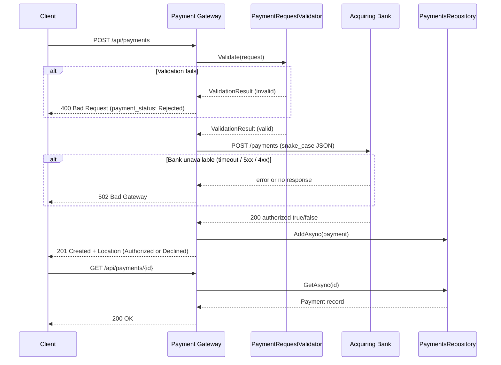
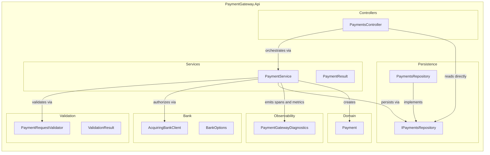

# Payment Gateway API

A payment gateway built in C# / .NET 10 as a Checkout.com Software Engineer I take-home assessment.
The gateway accepts payment requests from merchants, validates them, forwards them to an acquiring
bank simulator, and returns a typed result. Payments are stored in memory and retrievable by id.

## Table of Contents

1. [Quick Start](#quick-start)
2. [Architecture](#architecture)
3. [Project Structure](#project-structure)
4. [API Reference](#api-reference)
5. [Running Tests](#running-tests)
6. [Performance Testing (k6)](#performance-testing-k6)
7. [Observability](#observability)
8. [Design Decisions](#design-decisions)
9. [Assumptions](#assumptions)
10. [Next Steps](#next-steps)

---

## Quick Start

### Prerequisites

- [.NET 10 SDK](https://dotnet.microsoft.com/download/dotnet/10.0)
- [Docker Desktop](https://www.docker.com/products/docker-desktop/)

### Run the full stack (gateway + bank simulator)

```bash
git clone https://github.com/LuckMeelo/payment-gateway-api.git
cd payment-gateway-api

docker compose up --build
```

| Service | URL |
|---|---|
| Gateway API | http://localhost:8090 |
| Swagger UI | http://localhost:8090/swagger |
| Bank simulator | http://localhost:8080 |
| Mountebank admin | http://localhost:2525 |

### Run gateway only (bank simulator in Docker, gateway on .NET)

```bash
docker compose up -d bank_simulator

cd src/PaymentGateway.Api
dotnet run
```

The gateway listens on https://localhost:7092 / http://localhost:5000 by default.

### Health checks

```bash
curl http://localhost:8090/health/live    # 200 = process is up
curl http://localhost:8090/health/ready   # 200 = dependencies ready
```

---

## Architecture

### Request flow



### Component diagram



---

## Project Structure

```
payment-gateway-api/
├── src/
│   └── PaymentGateway.Api/
│       ├── Controllers/       # HTTP routing and response mapping only
│       ├── Services/          # Business logic (PaymentService, PaymentResult)
│       ├── Validation/        # Hand-written request validator + ValidationResult
│       ├── Bank/              # Typed HttpClient, bank DTOs, BankOptions
│       ├── Domain/            # Payment record (the persisted model)
│       ├── Persistence/       # IPaymentsRepository + ConcurrentDictionary impl
│       ├── Observability/     # ActivitySource, Meter, Counter, Histogram
│       └── Models/            # API request/response contracts (snake_case)
├── test/
│   └── PaymentGateway.Api.Tests/
│       ├── PaymentRequestValidatorTests.cs   # unit tests
│       ├── AcquiringBankClientTests.cs       # unit tests (WireMock.Net)
│       ├── PaymentServiceTests.cs            # unit tests (NSubstitute)
│       ├── PaymentsControllerTests.cs        # integration (WebApplicationFactory)
│       ├── HealthChecksTests.cs              # integration
│       ├── PaymentLoggingTests.cs            # integration (PAN safety)
│       └── PaymentGatewayE2ETests.cs         # E2E (live bank simulator)
├── docs/
│   ├── api.http               # Runnable HTTP examples (VS Code REST Client)
│   └── k6/
│       └── load-test.js       # k6 performance test script
├── imposters/
│   └── bank_simulator.ejs     # Mountebank imposter definition
├── Dockerfile                 # Multi-stage, non-root (APP_UID)
├── docker-compose.yml         # Gateway + bank simulator
└── .github/workflows/ci.yml   # Format, build, unit/integration tests, E2E, Docker build
```

---

## API Reference

See [`docs/api.http`](docs/api.http) for runnable examples.

### POST /api/payments

Processes a new payment. The bank is called only when the request passes all validation rules.

**Request body**

| Field | Type | Rules |
|---|---|---|
| `card_number` | string | 14-19 digits, no spaces or dashes |
| `expiry_month` | integer | 1-12 |
| `expiry_year` | integer | combined month/year must be in the future |
| `currency` | string | `GBP`, `EUR`, or `USD` (uppercase only) |
| `amount` | integer | positive integer in minor units (pence, cents) |
| `cvv` | string | 3-4 digits |

**Response body fields (201)**

| Field | Type | Notes |
|---|---|---|
| `id` | UUID string | Use this to call GET /api/payments/{id} |
| `status` | string | `"Authorized"` or `"Declined"` |
| `card_number_last_four` | string | Last 4 digits only — full PAN is never stored |
| `expiry_month` | integer | |
| `expiry_year` | integer | |
| `currency` | string | |
| `amount` | integer | |

**Responses**

| Status | Condition |
|---|---|
| `201 Created` | Authorized or Declined. Body contains the payment record; `Location` header points to the GET endpoint. |
| `400 Bad Request` | Validation failed. Body is ProblemDetails with `payment_status: "Rejected"` and an `errors` array. Bank is never called. |
| `502 Bad Gateway` | Bank unreachable, timed out, or returned a non-2xx response. Payment is not stored. |

### GET /api/payments/{id}

Retrieves a previously processed payment by its UUID.

| Status | Condition |
|---|---|
| `200 OK` | Payment found |
| `404 Not Found` | No payment with that id |

All responses use snake_case JSON. Error responses follow [RFC 9110 ProblemDetails](https://tools.ietf.org/html/rfc9110) and include a `trace_id` extension for correlation.

---

## Running Tests

### Unit and integration tests (no simulator required)

```bash
dotnet test --filter "Category!=E2E"
```

### End-to-end tests (requires the bank simulator)

```bash
docker compose up -d bank_simulator
dotnet test --filter "Category=E2E"
docker compose down
```

If the simulator is not running, the E2E tests fail immediately with an actionable message rather
than emitting confusing socket errors.

### Test card numbers

The bank simulator responds deterministically based on the last digit of the card number.

| Last digit | Outcome |
|---|---|
| 1, 3, 5, 7, 9 | Authorized |
| 2, 4, 6, 8 | Declined |
| 0 | Bank returns 503 (gateway returns 502) |

Example cards: `2222405343248871` (authorized), `2222405343248872` (declined), `2222405343248870` (unavailable).

### CI pipeline

Three jobs run on every push and pull request to `main`:

| Job | Depends on | What it does |
|---|---|---|
| `build` | nothing | Format check, build `-warnaserror`, unit and integration tests |
| `e2e` | `build` | Starts simulator, runs E2E tests, tears down |
| `docker` | `build` | Builds the multi-stage image to confirm the Dockerfile stays valid |

---

## Performance Testing (k6)

Requires [k6](https://grafana.com/docs/k6/latest/set-up/install-k6/) and the full stack running.

```bash
docker compose up -d

k6 run docs/k6/load-test.js

docker compose down
```

To target a different URL:

```bash
BASE_URL=http://localhost:8090 k6 run docs/k6/load-test.js
```

The script ramps to 10 virtual users over 10 seconds, holds at 10 VUs for 30 seconds, then ramps
down over 10 seconds. It exercises the full authorized-card POST then GET round-trip.

Configured thresholds:
- p95 response time under 500 ms
- Error rate under 5% (Mountebank is a single-threaded Node.js process; in production against a
  real bank this threshold would be tightened to under 0.1%)

---

## Observability

### Structured logs

All logs are emitted as JSON via `AddJsonConsole` for ingestion by log aggregators (Datadog, ELK,
Grafana Loki). No PAN (card number) or CVV ever appears in any log entry — this is verified by a
dedicated integration test (`PaymentLoggingTests`).

| Level | Event |
|---|---|
| `Debug` | Validation started, bank request dispatched, bank status received |
| `Information` | Payment rejected (with error count), payment processed (with id and status) |
| `Warning` | Bank unavailable, non-2xx bank status, request timeout, deserialization failure |

### Console exporter (development only)

Both traces and metrics use `AddConsoleExporter()`. This is intentional for the assessment
so the output is visible without running a collector. In production these would be replaced with
`AddOtlpExporter()` pointing to a Jaeger/Grafana Tempo instance (traces) and a Prometheus
scrape endpoint or OTLP collector (metrics).

The metrics console exporter prints all metric values every 10 seconds (the default periodic
export interval). You will see repeated blocks in the container logs — this is expected behaviour,
not a bug. Each block shows the cumulative counter values and histogram bucket distribution since
the process started.

### Distributed traces

Every inbound HTTP request produces an OpenTelemetry trace. A child span `bank.authorize` wraps
the outbound bank call so the bank latency is visible separately from gateway processing time.
W3C `traceparent` is forwarded automatically by HttpClient instrumentation.

### Metrics

| Metric | Type | Tag | Description |
|---|---|---|---|
| `payments.processed` | Counter | `status` | Count of payments by outcome (Authorized, Declined, Rejected, BankUnavailable) |
| `bank.request.duration` | Histogram (ms) | `outcome` | Round-trip bank call duration. Use p95/p99 for SLO thresholds. |

### Health endpoints

| Endpoint | Behaviour |
|---|---|
| `GET /health/live` | Returns `Healthy` if the process is up. No checks run. Used by orchestrators to decide whether to restart the container. |
| `GET /health/ready` | Runs all registered health checks. The acquiring bank is deliberately excluded so a bank outage does not pull gateway instances out of the load balancer rotation. |

### Trace correlation on errors

Every ProblemDetails error response includes a `trace_id` extension so support teams can correlate
a client-reported error to a specific trace in the observability backend.

---

## Design Decisions

| Decision | Rationale |
|---|---|
| `201 Created` for both Authorized and Declined | Both are completed bank decisions producing a stored, retrievable record. Using 201 for Declined avoids a misleading 402 and is consistent with how the Location header is used. |
| No retry on bank POST | The bank may have partially processed the payment. Retrying without an idempotency key risks a double charge. |
| Bank excluded from `/health/ready` | A bank outage must not drain the entire gateway fleet. The gateway can still serve GET requests and reject invalid POST requests while the bank is down. |
| `DOTNET_RUNNING_IN_CONTAINER` guards HTTPS redirect | The container runs as `Development` (to enable Swagger). Keying off the environment name would disable HTTPS redirect for the wrong reason; the container flag is the correct signal. |
| No Luhn validation | Luhn is the bank's responsibility. Failing early on Luhn would silently prevent testing declined cards whose numbers happen to fail Luhn. |
| In-memory store (`ConcurrentDictionary`) | Sufficient for the assessment scope. `IPaymentsRepository` abstracts the store so a database-backed implementation can be swapped in without touching business logic. |
| Hand-written validator over FluentValidation | Every rule is explicit, readable, and independently testable. No external dependency required. |
| `TimeProvider` injection for expiry validation | Allows tests to control the clock with `FakeTimeProvider` without affecting real-time behavior in production. |

---

## Assumptions

- Currency codes are uppercase only. `gbp` and `Gbp` are rejected.
- Amount is always in minor units. `100` means 100 pence (GBP) or 100 cents (USD/EUR), not 100 pounds.
- A card is valid until the end of its expiry month in UTC. A card with expiry `04/2025` is valid through `2025-04-30 23:59:59 UTC`.
- No Luhn check is performed. The gateway trusts the bank to validate card number checksums.
- Payments are stored in memory only. Restarting the gateway clears all records.
- The acquiring bank API is available at a single configurable URL. No retry or circuit breaker is applied on POST (see Next Steps).

---

## Next Steps

These are production concerns that are deliberately out of scope for this assessment.

**Idempotency keys**
Add an `Idempotency-Key` request header. On retry the gateway returns the original stored response
without calling the bank again, eliminating the double-charge risk on network timeouts. Requires a
second lookup store keyed by idempotency key alongside the existing payment id store.

**Persistent storage**
Replace `ConcurrentDictionary` with a database-backed repository (PostgreSQL via EF Core or Dapper).
The `IPaymentsRepository` abstraction means no other code changes are required.

**Authentication and authorisation**
Secure the API with API keys or OAuth 2.0 client credentials flow. Currently any caller can submit
and retrieve payments with no identity check.

**Circuit breaker on the bank client**
Add a Polly circuit breaker so repeated bank failures open the circuit and return 502 immediately
without waiting for the timeout on every request.

**Push image to registry**
Extend the `docker` CI job to push a tagged image to GHCR on merge to `main`, enabling automated
deployment pipelines.

**Rate limiting**
Add ASP.NET Core rate limiting middleware to protect against burst traffic from a single merchant
or a misconfigured client.

**Structured validation error codes**
Extend ProblemDetails with machine-readable error codes (e.g. `card_expired`, `invalid_currency`)
alongside the human-readable messages so clients can handle specific failures programmatically.
